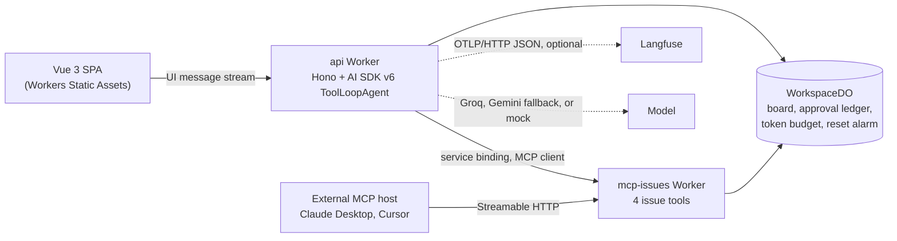

# DevSprint Copilot

[](https://github.com/EleoXDA/DevSprint/actions/workflows/ci.yml)

An AI copilot for a sprint board, built to show how an agent can be **useful without being trusted**:

- every answer is grounded in real tool calls
- every write waits for a human to approve it
- the same issue tools are served to outside AI assistants over MCP, writing to the same live board

**Live demo:** https://devsprint-web.eleo-666.workers.dev
**Public MCP server:** `https://devsprint-mcp-issues.eleo-666.workers.dev/mcp` (Streamable HTTP)
**Demo video:** _coming with the v1.0.0 release_

## Try it

The live demo runs a **scripted model**, so it answers the six demo scenarios' prompts, not
free-form questions. That's deliberate: it's free, deterministic, and can't be talked into
spending anyone's API quota. Paste these into the chat:

| Prompt                                                                                   | What you'll see                                                                                               |
| ---------------------------------------------------------------------------------------- | ------------------------------------------------------------------------------------------------------------- |
| `Summarize Sprint 12 and draft release notes for v1.5.0.`, then `Looks good, save it.`   | Three chained tool calls, a release-notes diff against v1.4.2, then an approval card before anything is saved |
| `We're closing Sprint 12 today — mark every remaining open issue in the sprint as done.` | Five separate approval cards, one per issue. Deny one with a reason and watch the agent say so                |
| `Deploy v1.5.0-rc.1 to staging.`                                                         | A gated deployment that streams build → test → migrate → release live, with a working Cancel                  |
| `Is Sprint 12 on track? Show me the burndown.`                                           | A burndown chart drawn from the tool's own series, and a narration that names the blocker                     |
| `Mark DS-42 as done — the billing export shipped this morning.`, then `Yes, that one.`   | A typed `ISSUE_NOT_FOUND` error, a search for what you meant, and a fresh approval for the fix                |
| _In Claude Desktop or Cursor_: add the MCP server above, then ask it to create an issue  | The write lands on the same board. Reload the demo to see it in the backlog                                   |

The board is shared by every visitor and resets itself at midnight UTC. **Reset demo** in the
header restores it at any time.

## How it works



A turn starts when the SPA streams a question to the **api Worker**. There, an AI SDK v6
`ToolLoopAgent` chains up to six tool calls before answering.

- **Reads run immediately** and come back as cards in the transcript: an issue table, a burndown
  chart, a release-notes diff.
- **Writes don't run until approved.** Each write becomes a signed approval card, and only an
  explicit, single-use approval lets it execute.
- **The four issue tools live in a separate MCP Worker,** which the agent reaches over a service
  binding as an ordinary MCP client. Any outside AI assistant can use the same server.
- **There's one board.** Both Workers read and write it through one Durable Object, so a write
  from Claude Desktop shows up in the SPA.

## Decisions worth reading

Each of these is an [ADR](docs/adr/README.md). Several record a plan that didn't survive contact
with the real thing, and say why.

| Decision                                                                                                                      | Why it's interesting                                                                                                                                              |
| ----------------------------------------------------------------------------------------------------------------------------- | ----------------------------------------------------------------------------------------------------------------------------------------------------------------- |
| [Approvals are signed, and single-use through our own ledger](docs/adr/0010-tool-approval-mechanism-and-replay-protection.md) | The SDK's signature has no nonce, so a captured approval could be replayed. The ledger closes that, with its two exceptions named rather than hidden              |
| [The workspace lives in a Durable Object](docs/adr/0011-workspace-state-in-a-durable-object.md)                               | It's what lets two Workers, and any outside MCP host, share one board. It replaced the planned D1 database                                                        |
| [Deployment cancel is an api route](docs/adr/0013-deployment-cancel-as-an-api-route.md)                                       | A browser that stops reading a stream does not reliably abort the Worker, so the run would finish while the card said "cancelled"                                 |
| [Tracing without the OpenTelemetry SDK](docs/adr/0015-otlp-tracing-without-the-opentelemetry-sdk.md)                          | About 200 hand-written lines. The "risky on workerd" assumption was measured, not believed                                                                        |
| [Two spend controls, deliberately different](docs/adr/0016-two-spend-controls-and-an-honest-injection-posture.md)             | Cloudflare's rate limiter disclaims being an accounting system, so the token cap lives elsewhere. Prompt injection is answered by the approval gate, not a prompt |
| [Scenario specs assert three layers](docs/adr/0018-scenario-specs-assert-three-layers.md)                                     | Green tests turned out to prove little. A mutation pass found ten product bugs every suite let through                                                            |
| [A deploy that bootstraps itself](docs/adr/0019-deploy-topology-and-spa-only-previews.md)                                     | The two Workers bind each other, so a first deploy has to break the cycle. Also why PR previews stop at the SPA                                                   |

## How it's tested, and what "green" was found not to prove

The recurring lesson of this repo is that **a passing suite is a claim, not proof**. So the
tests are checked as well as run:

- **Trajectory evals.** These check which tools the agent calls, in what order and with what
  arguments, against each demo scenario's own written assertions. They run in CI against the
  scripted model, and against a live model on demand (`EVAL_MODEL_PROVIDER=groq pnpm eval`).
- **One browser test per scenario.** Each checks three layers: the page, the stream the browser
  actually received (tool order, and approval strictly before execution), and the Durable Object.
  The last is there because a card and the database can disagree.
- **An audit of all 173 scenario requirements.** It found two evals passing for the wrong reason.
- **A mutation pass.** Ten one-line breaks were made deliberately, such as a frozen stats header,
  an upside-down chart, an empty progress bar, and successful writes shown in red. All ten passed
  every suite. Each now fails a test written for it.
- **Accessibility.** axe checks WCAG 2.2 AA across five UI states in both themes. Lighthouse's
  100 only ever sees the empty first page, and missed three real violations.
- **Deploy smoke checks.** Each one names the misconfiguration it catches.

**By the numbers:** 342 unit and eval tests, 29 browser tests, and Lighthouse 100 / 100 / 100 /
100 on the live site, on mobile and desktop.

## What it deliberately doesn't do

- **Per-visitor workspaces.** Multi-tenancy is a non-goal, so everyone shares one board, reset
  daily ([ADR-0014](docs/adr/0014-daily-reset-alarm-and-a-persisted-approval-ledger.md)).
- **A live model on the demo, for now.** Switching is one reviewed line, plus two secrets.
- **Markdown in chat.** Assistant text is shown as plain text on purpose: there's no `v-html` in
  the chat, as one layer of the injection posture.
- **A few planned UI pieces were never built:** the composer's one-click scenario buttons, the
  Sprint and Deploys tabs, a release-notes badge, and a distinct "interrupted" stage state. The
  [demo scenarios doc](docs/demo-scenarios.md) names each one, rather than describing them as if
  they existed.
- **API previews.** PR previews cover the SPA only, against the production api. A preview of the
  api would write to the live board.

## Running it locally

### Prerequisites

- [fnm](https://github.com/Schniz/fnm), which switches to Node 24.18 via `.node-version`
- corepack (`corepack enable`), which provides pnpm 11.10 as pinned in `packageManager`

### Getting started

```sh
git clone git@github.com:EleoXDA/DevSprint.git
cd DevSprint
corepack enable
pnpm install
pnpm dev        # web on :5173, api on :8787, mcp-issues on :8788
```

That runs end to end on the scripted model, with no keys and no account. To use a real model
locally, copy `apps/api/.dev.vars.example` to `apps/api/.dev.vars`, then set
`MODEL_PROVIDER=auto` and `GROQ_API_KEY` and/or `GOOGLE_GENERATIVE_AI_API_KEY`.

#### Model providers

Routing follows [ADR-0005](docs/adr/0005-model-routing-groq-primary-gemini-fallback.md). Groq
`llama-3.3-70b-versatile` is primary. Gemini `gemini-2.5-flash` is the fallback, used when Groq
fails with a retryable error, a 429 or a 5xx. `MODEL_PROVIDER` takes `auto`, `groq`, `gemini` or
`mock`. `wrangler.jsonc` sets `mock`, because that's what the deployed demo runs, and `.dev.vars`
overrides it locally. Each response reports the resolved route in the `X-DevSprint-Model` header.
Two spend controls bound a live model: 60 chat requests a minute per IP, and a 100,000-token
daily cap that the mock never counts against.

### Scripts

| Script              | What it does                                        |
| ------------------- | --------------------------------------------------- |
| `pnpm dev`          | all package dev servers in parallel                 |
| `pnpm lint`         | ESLint (single root flat config)                    |
| `pnpm format:check` | Prettier check                                      |
| `pnpm typecheck`    | recursive per-package typecheck                     |
| `pnpm test`         | recursive Vitest                                    |
| `pnpm eval`         | trajectory evals for the 6 demo scenarios           |
| `pnpm build`        | recursive builds (web: vite; api: wrangler dry-run) |
| `pnpm ci:local`     | CI's `checks` and `e2e` jobs, on this machine       |
| `pnpm deploy:all`   | deploy all three Workers, then smoke-check them     |
| `pnpm smoke`        | read-only checks against the live deployment        |

Browser tests live in `apps/web`:

```sh
pnpm --filter @devsprint/web test:e2e
```

Playwright starts all three servers itself and pins the scripted mock model, so the end-to-end
run needs no API key and never spends provider quota. It includes one test per demo scenario
(`e2e/scenarios.spec.ts`).

#### Running CI locally

`pnpm ci:local` runs the workflow's `checks` and `e2e` jobs on this machine, in about three
minutes. Use it whenever GitHub Actions cannot run. `--checks` or `--e2e` runs one job.

- **The steps come from `.github/workflows/ci.yml` itself,** so the two cannot drift.
- **It starts the e2e servers itself** (`apps/web/e2e/servers.ts`, shared with Playwright's
  config), waits until the api really reaches the MCP Worker, and stops them with SIGTERM so
  wrangler can leave its dev registry cleanly.
- **It never kills a process it did not start.** If a port the stack needs is taken, it names the
  process holding it and stops.
- **Logs go to `.ci-local/`.**

Prefer it to a bare `CI=1 … test:e2e` on a workstation. Playwright's own readiness probe reuses
its first connection, so another process on a port it polls can stall it until it times out.

**Package contract**: every workspace package exposes `typecheck` (web: `vue-tsc --noEmit`; others: `tsc --noEmit`) and, where meaningful, `test` (`vitest run`) and `build`. `pnpm -r` skips packages missing a script.

### Deploying

`pnpm deploy:all` deploys all three Workers in the one order that works and ends with smoke checks.
Pushes to `main` run it in CI once both test jobs pass. Details are in
[apps/api/README.md](apps/api/README.md#deploying) and
[ADR-0019](docs/adr/0019-deploy-topology-and-spa-only-previews.md).

## Repository layout

| Path              | Package                 | What it is                                                    |
| ----------------- | ----------------------- | ------------------------------------------------------------- |
| `apps/web`        | `@devsprint/web`        | Vue 3 SPA: Vite 8, Pinia, shadcn-vue (Reka UI, Tailwind v4)   |
| `apps/api`        | `@devsprint/api`        | Hono Worker: chat route, agent loop, workspace Durable Object |
| `apps/mcp-issues` | `@devsprint/mcp-issues` | Public issues MCP server, Streamable HTTP and stateless       |
| `packages/shared` | `@devsprint/shared`     | Domain types, tool schemas, seed fixtures                     |
| `scripts/`        | (root)                  | `deploy.ts`, `smoke.ts`, `ci-local.ts`                        |
| `docs/`           | (none)                  | Product brief, domain model, scenarios, wireframes, ADRs      |

The [roadmap](docs/roadmap.md) records all 16 phases, from design docs to this write-up, with what
each one actually found.

## Conventions

- Per-phase [Conventional Commits](https://www.conventionalcommits.org/); readable history is part of the portfolio.
- Dependency versions are pinned exactly in the `pnpm-workspace.yaml` default catalog (`catalog:` protocol); the AI SDK stays on the v6 line (`ai-v6` dist-tag) — npm `latest` is v7.
- TypeScript strict everywhere; one shared `tsconfig.base.json`; no project references.
- Single root ESLint flat config + Prettier; per-package configs are forbidden.

## License

[MIT](LICENSE)
