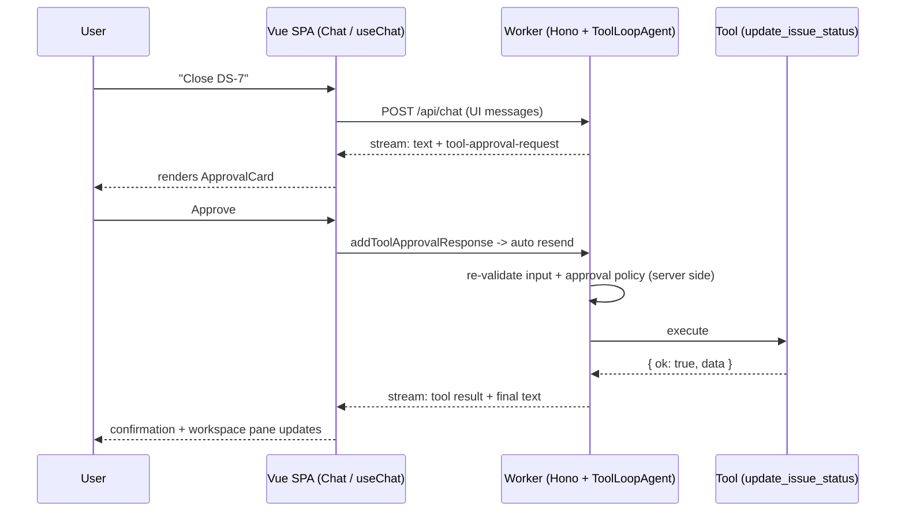

# Wireframes

Canonical UI reference for the DevSprint Copilot SPA — Vue 3 (3.6-track) with shadcn-vue,
talking to the Hono Worker described in [product-brief.md](./product-brief.md). Component names in
Section 5 are the canonical names for Phase 7; the board contents below are the exact seed from
[domain-model.md](./domain-model.md) at `WORKSPACE_NOW`, captured mid-scenario S-A
([demo-scenarios.md](./demo-scenarios.md)).

## 1. App shell — two-pane layout

```
+---------------------------------------------------------------------------------------------------+
| DevSprint Copilot     [Sprint 12 — Notifications & billing v]      [Reset board] [Theme]           |
+-------------------------------------------------+-------------------------------------------------+
| WORKSPACE                                       | COPILOT                                         |
| [ Board ] [ Sprint ] [ Deploys ]                |                                                 |
|                                                 |  +-------------------------------------------+  |
| Committed 31 | Done 8 | Remaining 23 | 4d left  |  | user > Summarize Sprint 12 and draft      |  |
|                                                 |  |        release notes for v1.5.0           |  |
| +--------+----------+-----------+------+------+ |  +-------------------------------------------+  |
| | Todo   | In Prog  | In Review | Blkd | Done | |                                                 |
| +--------+----------+-----------+------+------+ |  assistant: Sprint 12 is 26% done...            |
| |        | DS-9 (5) | DS-7 (5)  |DS-11 | DS-5 | |  (markdown text part, streamed token by token)  |
| |        | DS-10(8) | DS-8 (2)  | (3)  | DS-6 | |                                                 |
| |        |          |           |      |      | |  [tool] get_sprint_status    (collapsed JSON)   |
| +--------+----------+-----------+------+------+ |                                                 |
|                                                 |  +--[ ReleaseNotesDiff card ]----------------+  |
| Backlog: DS-12, DS-13                           |  | v1.4.2 -> v1.5.0 draft    [before|after]  |  |
|                                                 |  +-------------------------------------------+  |
|                                                 |                                                 |
|                                                 |  +--[ ApprovalCard ]-------------------------+  |
|                                                 |  | create_release_notes  v1.5.0              |  |
|                                                 |  | args summary...     [ Deny ] [ Approve ]  |  |
|                                                 |  +-------------------------------------------+  |
|                                                 |                                                 |
|                                                 |  +-------------------------------[Stop reply]+  |
|                                                 |  | Ask the copilot...                [Send]  |  |
|                                                 |  +-------------------------------------------+  |
+-------------------------------------------------+-------------------------------------------------+
```

Annotations:

- **Left pane — live workspace.** Tool effects appear here as the agent acts: approve a
  `update_issue_status` card in the chat and the issue moves columns immediately; a deployment
  approved in chat adds a row to the Deploys tab while it streams.
- **Board — five columns**, mapping 1:1 to `IssueStatus`: `todo` / `in_progress` / `in_review` /
  `blocked` / `done` ("In Prog" and "Blkd" are abbreviated only in this ASCII sketch). Cards show
  the issue key and points; the stat cards above the board (Committed, Completed, Remaining with
  its gap to the ideal burndown line, and Days left) are computed in the SPA from the workspace
  snapshot (`sprint-stats.ts`, sharing the ideal line with `get_burndown`), not from a
  `get_sprint_status` result. The board re-reads when a turn settles and when the reader returns
  to the tab (throttled, never mid-turn; it does not poll), and says when it was last read. A
  read that fails after a good one keeps that board and says "Offline" beside its time.
- **Right pane — chat.** In-stream parts render in strict transcript order (see Section 2). The
  composer sits at the bottom. Up in an empty composer recalls the session's earlier prompts, and
  Down walks forward, as in a shell. While approval cards are open the composer takes a draft but
  Send waits until they are answered. The empty transcript (before the first message, so not in
  the sketch above) offers the five chat scenarios (S-A through S-E) as quiet pill suggestions,
  each labelled by its outcome and sending the verbatim scenario prompt, then Graphite lines: the
  board is shared and resets at 00:00 UTC, messages go to third-party AI providers, and the MCP
  endpoint with a Copy button, since S-F runs in an external MCP host:

  ```
  Ask how the sprint is going, or tell the copilot what to change.
  (Is the sprint on track?) (Draft release notes) (Close out the sprint)
  (Deploy to staging) (Mark DS-42 as done)
  Every visitor shares this board. It resets at 00:00 UTC.
  Messages go to third-party AI providers (Groq, Google Gemini) and may be logged.
  Don’t enter personal information.
  Any MCP client can work on it too: [Copy]
  https://devsprint-mcp-issues.eleo-666.workers.dev/mcp
  ```

- **Header.** Sprint selector, demo reset, theme toggle. Reset restores the seed workspace for
  every visitor, so it asks "Reset for everyone?" inline before it does. Below `lg` a "Copilot ↓"
  control takes the reader down to the composer.
- **Stop button** ("Stop reply") is visible only while the agent is streaming; it aborts the
  agent loop mid-turn, and its label says it stops the reply, not a deployment. Scenario S-C variant C2 uses the card-level Cancel instead, which is a different
  mechanism as well as a different control: Stop aborts the request, Cancel posts to the api. It has
  to, because aborting does not reliably reach a deploy already in flight
  ([ADR-0013](adr/0013-deployment-cancel-as-an-api-route.md)).

## 2. In-stream part anatomy

Vertical order of parts within a single assistant turn (any part type may repeat or be absent;
order is always transcript order):

```
assistant turn (top to bottom)

 1. text part                 streamed markdown prose
 2. tool chip (ToolCallChip)  tool name + collapsed args/result JSON;
                              the Phase 3 fallback rendering for any tool
                              without a dedicated card
 3. rich card                 IssueTable | BurndownChart | ReleaseNotesDiff
 4. ApprovalCard              pending state blocks further tool execution
                              until the user approves or denies
 5. DeploymentProgressCard    stage list build / test / migrate / release,
                              each stage with a pending / running / succeeded
                              / failed / skipped glyph, a progress bar counting
                              whole stages, and the last log line; Cancel
                              button while the run is live
 6. ErrorCard                 one line per error code in the board's words
                              ("No issue DS-42 on the board.") + tool name and
                              code, subdued styling
```

## 3. ApprovalCard anatomy

```
+----------------------------------------------------------+
| DS-7: In review → Done                                   |
| "Billing export CSV download"                            |
| update_issue_status                                      |
|                                                          |
| > Raw arguments (collapsed JSON, click to expand)        |
+----------------------------------------------------------+
| [ Deny  (optional reason input) ]          [ Approve ]   |
+----------------------------------------------------------+
```

- **Headline**: human-readable args summary (here `DS-7: In review → Done`; statuses use the
  labels in `status-labels.ts`, never the raw enum). No label sits above it.
- **Body**: the issue title, then the tool name as a quiet mono meta line, with the raw JSON
  arguments behind a collapsible disclosure. What the write would store is shown above the
  disclosure: a new issue's assignee, priority, points, labels and description, the release notes
  it would save, or the comment on a move to blocked, as plain text in a box that scrolls. Blank
  lines at the top and long runs of them are dropped from the box, not from the raw arguments, and
  a line under it says when the text runs past it.
- **Footer**: Deny (with an optional free-text reason input) and Approve.
- **Resolved state** replaces the footer once the user acts; the card stays in the transcript as
  an audit record:

```
+----------------------------------------------------------+
| DS-7: In review → Done                                   |
| ● Approved by you at 14:02 — applied.                    |
+----------------------------------------------------------+

+----------------------------------------------------------+
| DS-11: Blocked → Done                                    |
| – Denied by you at 14:03: "Still blocked on vendor       |
|   sandbox".                                              |
+----------------------------------------------------------+
```

The headline keeps its "from" status after the decision: the board's status is captured, with
the time, when the person answers. The time is the reader's locale on a 24-hour clock. The glyph
follows the deployment card (● applied, ◐ still running, – denied or cancelled, ✕ failed). A
write that returned a typed error reads `✕ Approved by you at 14:02 — not applied.` in Stop Red,
and the ErrorCard right below explains it and carries the code (the status line, which does not
read that card, says `… — not applied (<CODE>).`). An `INTERNAL` error may have landed, so it reads
`✕ Approved by you at 14:02 — outcome unknown.` instead. A call that threw, with no ErrorCard, reads
`✕ Approved by you at 14:02, but it failed: <reason>`. A deployment reads
`Approved by you at 14:02 — deployment <status>.` (for example `deployment succeeded`).

**Reassignment.** An `assign_issue` card reads like a status change, with people in place of
statuses: by @handle as the board names them, and nobody as "Unassigned". The headline keeps its
"from" assignee after the decision the same way. An id nobody on the team has gets the Stop Red
warning line, and Deny takes the Ink, as a missing key does:

```
+----------------------------------------------------------+
| DS-12: Unassigned → @dana                                |
| "Dark mode theme audit"                                  |
| assign_issue                                             |
+----------------------------------------------------------+

+----------------------------------------------------------+
| DS-12: Unassigned → u-zed                                |
| "Dark mode theme audit"                                  |
| No one on the team has the id u-zed.        (Stop Red)   |
| assign_issue                                             |
+----------------------------------------------------------+
```

While the card is open, the issue's board card takes the same dashed ring as a pending move, and
stays in its column: a caption under the current assignee names who it would go to (`→ @dana`, or
`→ Unassigned`; screen readers hear "Awaiting approval to assign to @dana"). Backlog cards show
their assignee too, so the hand-on reads there as well:

```
+- - - - - - - - - - - - - - - -+
: DS-12                     [3] :
: Dark mode theme audit         :
: → @dana                       :
: Todo                          :
+- - - - - - - - - - - - - - - -+
```

**Group header and Approve all.** Two or more approval cards in one message's current round get a
header line above the round's first. Cards that already ran stay above it. When two or more of the open cards on the last message are board writes that
can land, it also carries "Approve all N", the message's one Ink, and every card below decides in
outline. Cards it leaves are named under it:

```
5 changes to review · 23 pts                [ Approve all 4 ]
DS-42 needs its own decision.
+----------------------------------------------------------+
| DS-7: In review → Done                                   |
| ...                                                      |
| [ Deny  (optional reason input) ]          [ Approve ]   |  <- outline
+----------------------------------------------------------+
```

After a card is answered on its own the button reads "Approve remaining 3". Deploys, release notes
and a status change for a key the board does not hold never count, and neither does a reassignment
whose key or person the board does not hold, or that would hand the issue to whoever already has it.
The press still answers each card through its own approval, so each keeps its own record line.

**Undo.** An applied status change, reassignment or new issue gets a quiet ghost Undo on its record
line; once undone, a second line follows it, or the board's refusal in Stop Red:

```
+----------------------------------------------------------+
| DS-9: In progress → Done                                 |
| ● Approved by you at 14:02 — applied.          [ Undo ]  |
+----------------------------------------------------------+

+----------------------------------------------------------+
| DS-9: In progress → Done                                 |
| ● Approved by you at 14:02 — applied.                    |
| ↶ Undone by you at 14:05 — DS-9 back to In progress.     |
+----------------------------------------------------------+
```

A reassignment undone reads `↶ Undone by you at 14:05 — DS-12 back to unassigned.` (or `— DS-7 back
to @ben.`). Release notes and deployments have no Undo. A refusal reads `That change to DS-9 can’t
be undone: the board has moved on.`, and the Undo does not come back.

## 4. HITL approval sequence



The server-side re-validation step is mandatory: client-controlled message history cannot be
trusted, so the Worker re-checks the tool input and the approval policy before executing. See
[tool-inventory.md](./tool-inventory.md) Section 3 and ADR-0003.

## 5. Component registry

Canonical component names for Phase 7 — spell them exactly like this everywhere (docs, code,
scenario specs).

| Component                                | Fed by                                                                                                       | First built in phase |
| ---------------------------------------- | ------------------------------------------------------------------------------------------------------------ | -------------------- |
| ChatMessageList                          | every message (user and assistant bubbles; wraps all parts below)                                            | 1                    |
| ChatText                                 | assistant text parts, safe markdown subset without v-html (ADR-0022)                                         | 15                   |
| ToolResultCard                           | picks the card per tool for a finished call (ErrorCard for `ok: false`); falls back to ToolCallChip          | 7                    |
| ToolCallChip                             | fallback for every tool call; permanent rendering for get_sprint_status and get_deployment_history results   | 3                    |
| IssueTable                               | list_issues; search_issues (compact variant)                                                                 | 7                    |
| BurndownChart (inline SVG, see ADR-0012) | get_burndown                                                                                                 | 7                    |
| ReleaseNotesDiff                         | diff_release_notes                                                                                           | 7                    |
| DeploymentProgressCard                   | run_deployment, redrawn from each preliminary tool result                                                    | 8                    |
| ApprovalCard                             | approval requests from create_issue, update_issue_status, assign_issue, create_release_notes, run_deployment | 5                    |
| ErrorCard                                | any tool result with ok: false                                                                               | 5                    |

## 6. Notes

- **Responsive behavior**: below 1024px (Tailwind `lg`) the two panes stack and the page scrolls.
  The board comes first at its natural height, then the copilot, divided by a hairline and given a
  full screen of its own (`max-lg:h-dvh`). There are no tabs. From `lg` up, the panes share a
  locked viewport and each scrolls on its own.
- **Current scope**: this wireframe is the TARGET layout. The repo ships the two panes, the header
  with Reset board (confirmed inline) and the theme toggle, a four-stat row (Committed, Completed,
  Remaining with its pace against the ideal line, Days left), the 5-column board plus backlog, and
  a composer backed by the real agent loop.
  Assistant text renders a safe markdown subset with no `v-html` (ChatText, ADR-0022).
  ToolCallChip is the fallback for every tool call and the permanent rendering for
  get_sprint_status and get_deployment_history. IssueTable, BurndownChart, ReleaseNotesDiff and
  DeploymentProgressCard (with a live Cancel, ADR-0013) render as cards, and ErrorCard handles any
  `ok: false` result. Stop aborts the loop mid-turn, and a call it interrupts is labelled
  `stopped`. Every write is gated by an ApprovalCard that stays in the transcript, and Send waits
  until outstanding cards are answered (a draft can be typed meanwhile). The empty transcript
  offers the scenario suggestions and the MCP endpoint. Still unbuilt: the sprint selector and the
  Board/Sprint/Deploys tabs.
- **Auto-scroll**: the chat pane follows new tokens with scroll-anchoring; a manual scroll-up, or
  focus moving up to an approval card, releases the anchor. Scrolling back to the bottom re-engages
  it, and so does every new request, the reader's own or the resend after the last approval, so
  the reply to a decision lands in view.
