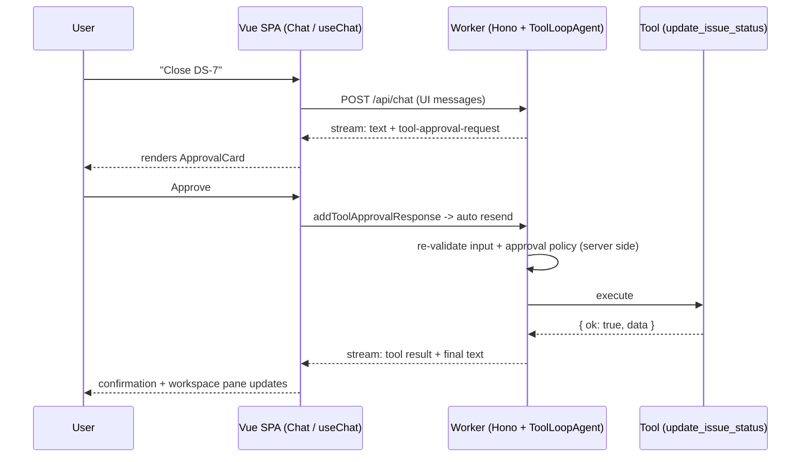

# Wireframes

Canonical UI reference for the DevSprint Copilot SPA — Vue 3 (3.6-track) with shadcn-vue,
talking to the Hono Worker described in [product-brief.md](./product-brief.md). Component names in
Section 5 are the canonical names for Phase 7; the board contents below are the exact seed from
[domain-model.md](./domain-model.md) at `WORKSPACE_NOW`, captured mid-scenario S-A
([demo-scenarios.md](./demo-scenarios.md)).

## 1. App shell — two-pane layout

```
+---------------------------------------------------------------------------------------------------+
| DevSprint Copilot     [Sprint 12 — Notifications & billing v]      [Reset demo] [Theme]           |
+-------------------------------------------------+-------------------------------------------------+
| WORKSPACE                                       | COPILOT                                         |
| [ Board ] [ Sprint ] [ Deploys ]                |                                                 |
|                                                 |  +-------------------------------------------+  |
| Committed 31 | Done 8 | Remaining 23 | 4d left  |  | user > Summarize Sprint 12 and draft      |  |
|                                                 |  |        release notes for v1.5.0           |  |
| +--------+----------+-----------+------+------+ |  +-------------------------------------------+  |
| | Todo   | In Prog  | In Review | Blkd | Done | |                                                 |
| +--------+----------+-----------+------+------+ |  assistant: Sprint 12 is 26% done...            |
| |        | DS-9 (5) | DS-7 (5)  |DS-11 | DS-5 | |  (markdown text part, streamed token by token)  |
| |        | DS-10(8) | DS-8 (2)  | (3)  | DS-6 | |                                                 |
| |        |          |           |      |      | |  [tool] get_sprint_status    (collapsed JSON)   |
| +--------+----------+-----------+------+------+ |                                                 |
|                                                 |  +--[ ReleaseNotesDiff card ]----------------+  |
| Backlog: DS-12, DS-13                           |  | v1.4.2 -> v1.5.0 draft    [before|after]  |  |
|                                                 |  +-------------------------------------------+  |
|                                                 |                                                 |
|                                                 |  +--[ ApprovalCard ]-------------------------+  |
|                                                 |  | create_release_notes  v1.5.0              |  |
|                                                 |  | args summary...     [ Deny ] [ Approve ]  |  |
|                                                 |  +-------------------------------------------+  |
|                                                 |                                                 |
|                                                 |  +-------------------------------------[Stop]+  |
|                                                 |  | Ask the copilot...                [Send]  |  |
|                                                 |  +-------------------------------------------+  |
|                                                 |  (scenario buttons: [S-A] [S-B] ... [S-E])      |
+-------------------------------------------------+-------------------------------------------------+
```

Annotations:

- **Left pane — live workspace.** Tool effects appear here as the agent acts: approve a
  `update_issue_status` card in the chat and the issue moves columns immediately; a deployment
  approved in chat adds a row to the Deploys tab while it streams.
- **Board — five columns**, mapping 1:1 to `IssueStatus`: `todo` / `in_progress` / `in_review` /
  `blocked` / `done` ("In Prog" and "Blkd" are abbreviated only in this ASCII sketch). Cards show
  the issue key and points; the stat chips above the board come from `get_sprint_status` data.
- **Right pane — chat.** In-stream parts render in strict transcript order (see Section 2). The
  composer sits at the bottom; scripted scenario buttons (S-A through S-E; S-F runs in an external
  MCP host) fill the composer with the verbatim scenario prompt as a spend control.
- **Header.** Sprint selector, demo reset, theme toggle. Reset restores the seed workspace.
- **Stop button** is visible only while the agent is streaming; it aborts the agent loop
  mid-turn (scenario S-C variant C2 uses the card-level Cancel instead).

## 2. In-stream part anatomy

Vertical order of parts within a single assistant turn (any part type may repeat or be absent;
order is always transcript order):

```
assistant turn (top to bottom)

 1. text part                 streamed markdown prose
 2. tool chip (ToolCallChip)  tool name + collapsed args/result JSON;
                              the Phase 3 fallback rendering for any tool
                              without a dedicated card
 3. rich card                 IssueTable | BurndownChart | ReleaseNotesDiff
 4. ApprovalCard              pending state blocks further tool execution
                              until the user approves or denies
 5. DeploymentProgressCard    stage list build / test / migrate / release,
                              each stage with a pending / running / succeeded
                              / failed icon, a progress bar, and the last log
                              line; Cancel button while running
 6. ErrorCard                 error code + message, subdued styling
```

## 3. ApprovalCard anatomy

```
+--[ Approval required: update_issue_status ]--------------+
| DS-7: in_review -> done                                  |
| "Billing export CSV download"                            |
|                                                          |
| > Raw arguments (collapsed JSON, click to expand)        |
+----------------------------------------------------------+
| [ Deny  (optional reason input) ]          [ Approve ]   |
+----------------------------------------------------------+
```

- **Header**: `Approval required: <tool name>`.
- **Body**: human-readable args summary (here `DS-7: in_review -> done` plus the issue title),
  with the raw JSON arguments behind a collapsible disclosure.
- **Footer**: Deny (with an optional free-text reason input) and Approve.
- **Resolved state** replaces the footer once the user acts; the card stays in the transcript as
  an audit record:

```
+----------------------------------------------------------+
| Approved by you at 14:02                                 |
+----------------------------------------------------------+

+----------------------------------------------------------+
| Denied: "Still blocked on vendor sandbox"                |
+----------------------------------------------------------+
```

## 4. HITL approval sequence



The server-side re-validation step is mandatory: client-controlled message history cannot be
trusted, so the Worker re-checks the tool input and the approval policy before executing. See
[tool-inventory.md](./tool-inventory.md) Section 3 and ADR-0003.

## 5. Component registry

Canonical component names for Phase 7 — spell them exactly like this everywhere (docs, code,
scenario specs).

| Component                                 | Fed by                                                                                                     | First built in phase |
| ----------------------------------------- | ---------------------------------------------------------------------------------------------------------- | -------------------- |
| ChatMessage                               | every message part (user and assistant text; wraps all parts below)                                        | 2                    |
| ToolCallChip                              | fallback for every tool call; permanent rendering for get_sprint_status and get_deployment_history results | 3                    |
| IssueTable                                | list_issues; search_issues (compact variant)                                                               | 7                    |
| BurndownChart (shadcn-vue Chart / Unovis) | get_burndown                                                                                               | 7                    |
| ReleaseNotesDiff                          | diff_release_notes                                                                                         | 7                    |
| DeploymentProgressCard                    | run_deployment progress parts                                                                              | 8                    |
| ApprovalCard                              | approval requests from create_issue, update_issue_status, create_release_notes, run_deployment             | 5                    |
| ErrorCard                                 | any tool result with ok: false                                                                             | 5                    |

## 6. Notes

- **Responsive behavior**: below 1024px the two panes stack vertically — chat first, workspace
  behind a tab — so the phone experience is chat-led.
- **Current scope**: this wireframe is the TARGET layout. The repo currently ships the two panes,
  the 5-column board with seed data, and a composer backed by the real agent loop, which chains
  several tools in one turn (Phase 4); ToolCallChip renders every tool call — name, state,
  collapsed args/result JSON — as the fallback rendering and the permanent one for
  get_sprint_status and get_deployment_history. The other read tools now render as cards:
  IssueTable, BurndownChart and ReleaseNotesDiff, with ErrorCard for any `ok: false` result. The Stop button aborts the loop mid-turn, and a call it interrupts is labelled `stopped`
  rather than left claiming to run. Every write the agent can make is gated: an ApprovalCard renders per gated call and
  stays in the transcript afterwards as the record of what was decided, while the composer is locked
  until the outstanding cards are answered. Tabs, sprint selector, and scenario buttons are still
  pending (Phase 7+).
- **Auto-scroll**: the chat pane follows new tokens with scroll-anchoring; a manual scroll-up
  releases the anchor (a jump-to-bottom affordance re-engages it).
